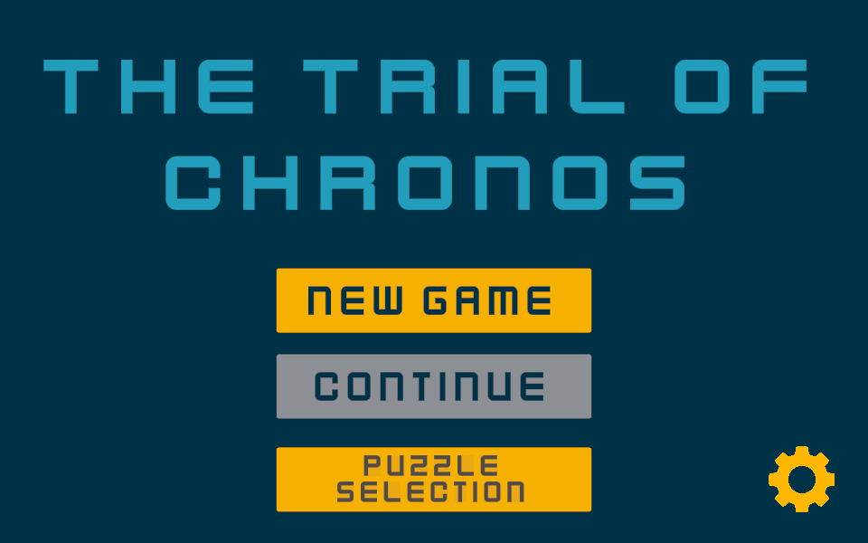
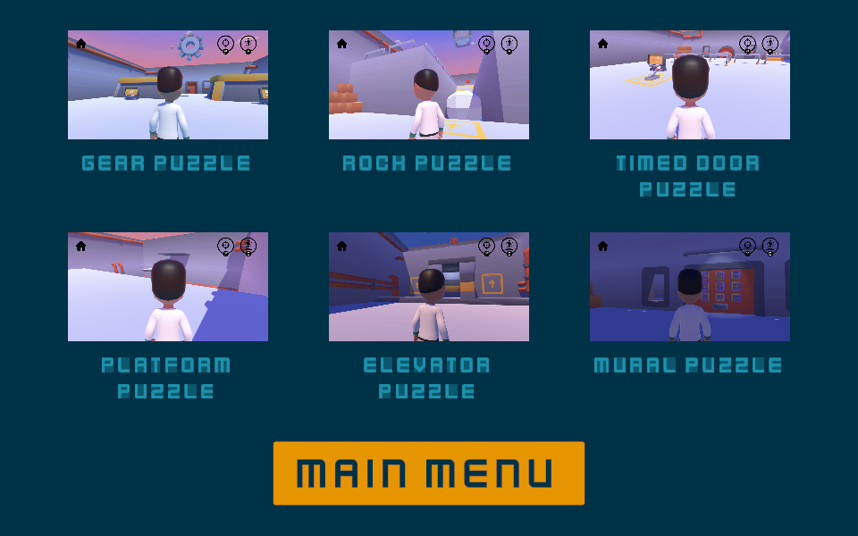

# The Trial of Chronos

A 3D puzzle game built in Unity around two time-and-space mechanics: **rewinding objects through time** and **teleporting back to a clone you leave behind**. I designed and built it on my own as my final-year project, from concept to a playable game with six levels in four months.

**[▶ Play it in your browser](https://sean030531.github.io/The-Trial-of-Chronos/)** (keyboard and mouse)

  
  

## Core mechanics

| Mechanic | Controls | What it does |
|---|---|---|
| **Rewind** | Right-click to aim, left-click to rewind | Sends a target object back along the path it has travelled, so objects such as falling rocks or a shattered mural can be restored |
| **Clone** | E to leave a clone, Q to teleport to it | Saves your position as a clone, then lets you return to it instantly |

Movement is WASD, with the mouse controlling the camera.

## Levels

1. **Gear Puzzle**
2. **Rock Puzzle**
3. **Timed Door Puzzle**
4. **Platform Puzzle**
5. **Elevator Puzzle**
6. **Mural Puzzle**

Every level can be played from the puzzle selection screen.

## Playtesting and iteration

I ran three rounds of playtesting with 15 players. The main problem it revealed: in levels that needed both mechanics, players got stuck because they could not tell **which ability to use**.

I added UI cues that highlight the usable mechanic before frustration sets in. The level clear rate rose from **47% to 80%**.

The Gear Puzzle also went through a full redesign after its first version did not work as intended. The original version is kept in `Assets/Scenes/Old Level 1 Gear Puzzle.unity`.

## Code

All gameplay scripts are in [`Assets/Scripts`](Assets/Scripts), about 1,900 lines of C#. Key ones:

| Script | Responsibility |
|---|---|
| `RecallMechanic.cs`, `RewindableObject.cs`, `RewindableMural.cs` | Recording object history and playing it back for the rewind mechanic |
| `CloneMechanic.cs` | Saving the clone point and teleporting back to it |
| `PlayerController.cs`, `CameraFollow.cs` | Third-person movement and camera |
| `PuzzleDoor.cs`, `TimedDoorLever.cs`, `ElevatorButton.cs`, `*PlatformMover.cs` | Puzzle elements |
| `GameManager.cs`, `ChangeScenes.cs`, `MusicManager.cs`, `SoundMixerManager.cs` | Game flow, scene loading, audio and settings |

## Open in Unity

Unity **2022.3.54f1** (LTS). Open the project folder and start from `Assets/Scenes/UI Home Page.unity`. The browser build is in `docs/`.

## Credits

- Characters, environment and UI assets: [Kenney](https://kenney.nl) (CC0)
- Skybox: *Skybox Cubemap Extended* by BOXOPHOBIC (Unity Asset Store)

## Context

Final Project (CM3070) for my BSc Computer Science (University of London, Goldsmiths).
